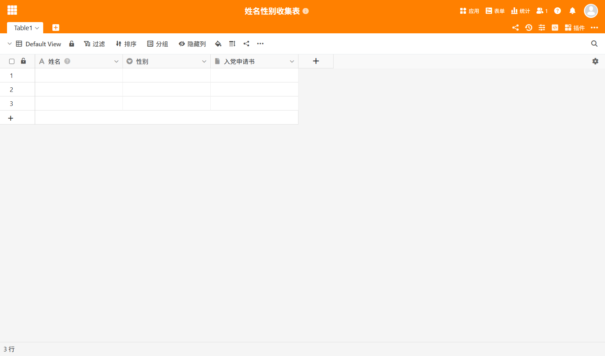
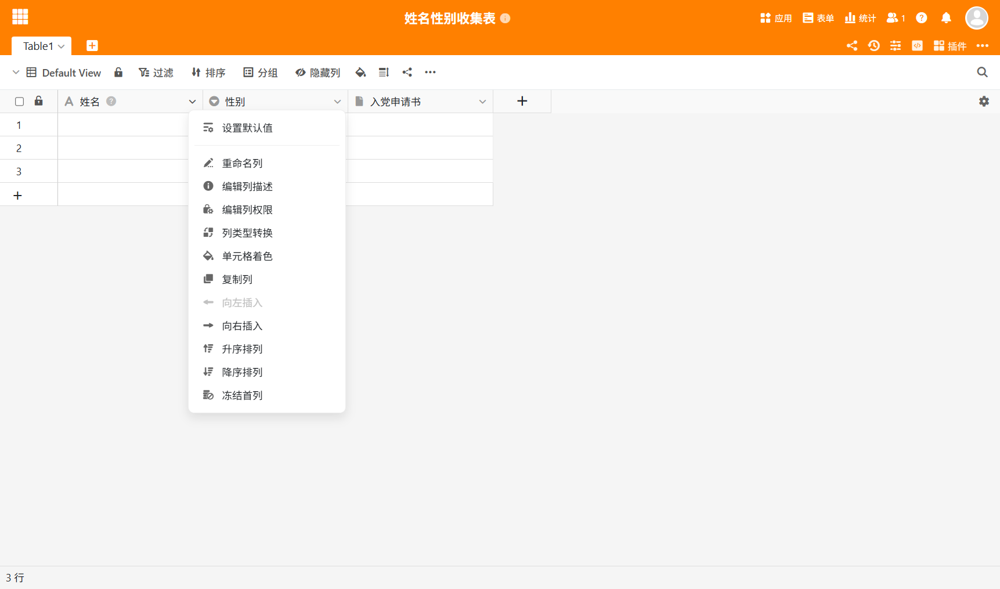
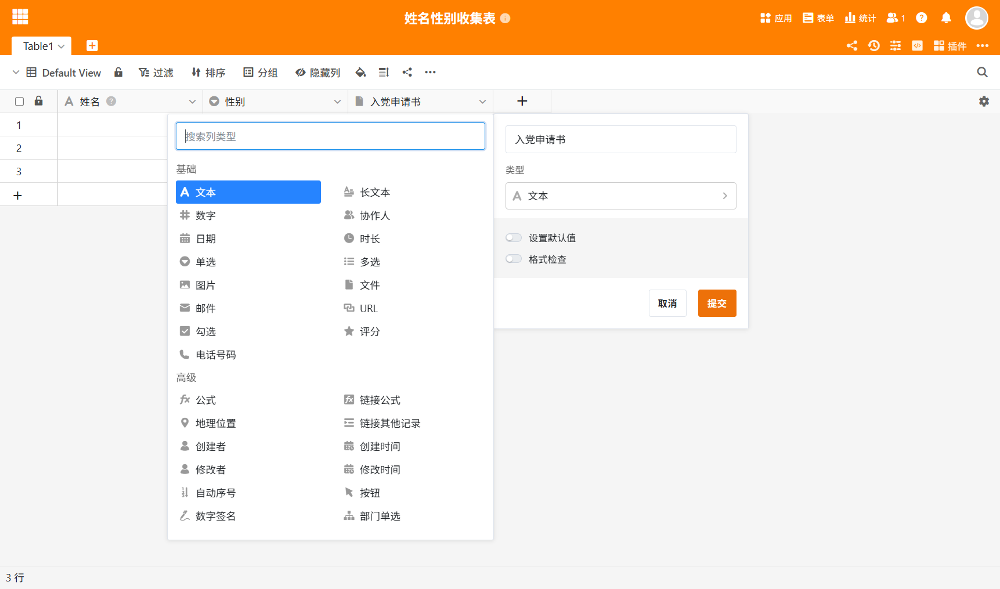
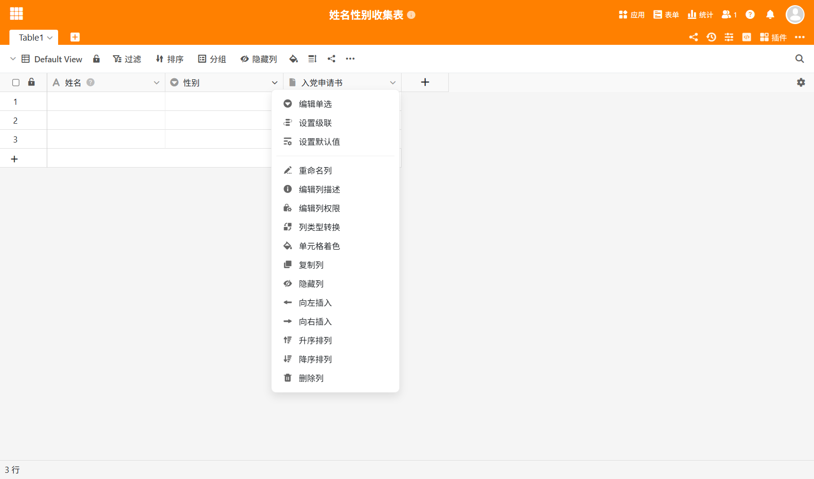
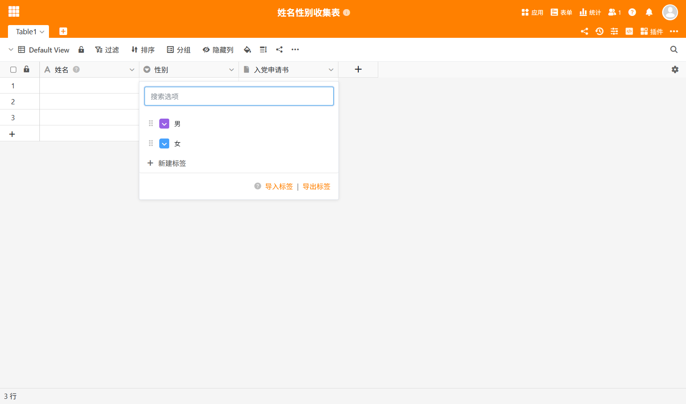
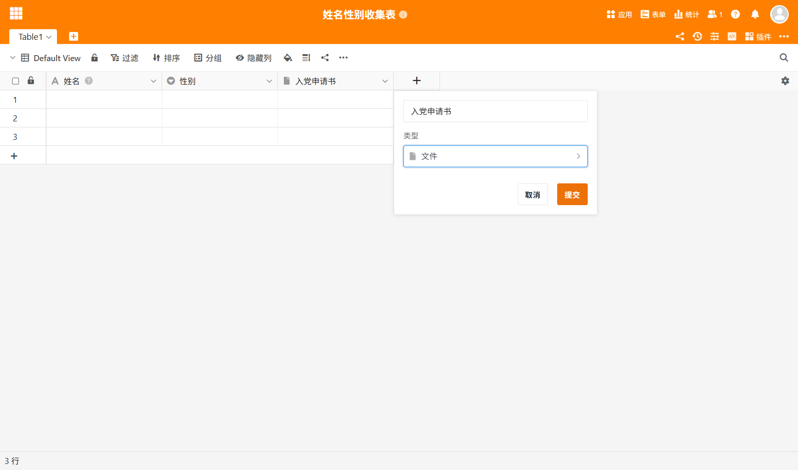

# 第 1 章：创建表格和字段

这一章先搭好数据结构。目标不是立刻把链接发出去，而是让每次提交都能落到正确的列中。

## 本章目标

你将创建一张表，并准备三种典型字段：

- 文本字段：保存姓名或标题。
- 单选字段：让填写者从固定选项中选一个。
- 文件字段：接收附件。

图中的示例名称只是演示。实际使用时，可以把“性别”换成“材料类型”，把“入党申请书”换成“附件”或其他名称。

## 1. 创建空白表

打开 [NJUtable](https://table.nju.edu.cn/) 并按页面提示登录。进入“我的表格”后，找到“创建一个空白表”。

输入一个能让协作者看懂的名称，例如“材料收集表”，按回车确认，再点击表格名称进入。

命名时尽量避免只写“表格 1”“新表格”。名称至少应该说明用途，必要时再加活动或日期范围。

## 2. 认识表格页面

每一列代表一种字段，每一行代表一条记录。表头最右侧的加号用于新增字段，表格底部的加号用于新增记录。

<figure markdown="span">
  
  <figcaption>表头右侧加号新增字段，表格下方加号新增记录。</figcaption>
</figure>

创建字段前先写一张小清单：要收集什么、每项允许填什么、是否需要附件。字段类型一旦选择错误，后续整理数据会更麻烦。

## 3. 把默认字段改成中文

新建表的第一列可能叫 `Name`。点击列表头的小箭头，选择“重命名列”，把它改成“姓名”或其他合适名称。

<figure markdown="span">
  
  <figcaption>从列表头的小箭头进入列设置，再选择“重命名列”。</figcaption>
</figure>

姓名、标题、备注等内容适合使用文本类型。不要因为内容里偶尔包含数字就改成数字字段，例如学号如果可能包含前导零，通常仍应按文本处理。

## 4. 新增单选字段

点击表头最右侧的加号，在“列名”中填写字段名称，再展开“类型”，选择“单选”。

<figure markdown="span">
  
  <figcaption>先填写列名，再选择字段类型，最后提交保存。</figcaption>
</figure>

单选适合“每条记录只能有一个答案”的问题，例如材料类型、处理状态或是否参加。若同一条记录可以同时选择多项，应改用多选类型。

创建字段后，点击列表头的小箭头，选择“编辑单选”。

<figure markdown="span">
  
  <figcaption>在单选字段的列设置中进入“编辑单选”。</figcaption>
</figure>

在搜索框输入选项文字，选择“新建标签”，逐个添加需要的选项。确认列表中已经出现全部选项后，点击空白处关闭窗口。

<figure markdown="span">
  
  <figcaption>选项列表应覆盖所有允许填写的情况。</figcaption>
</figure>

## 5. 新增文件上传字段

再次点击表头右侧加号，填写字段名称，例如“附件”，然后把类型设置为“文件”。

<figure markdown="span">
  
  <figcaption>提交前同时检查字段名称和“文件”类型。</figcaption>
</figure>

文件字段只解决“允许上传”的问题。正式使用前还要明确文件格式、大小、命名方式和是否包含敏感信息，并用测试文件实际提交一次。

## 6. 本章验收

回到表格页面，逐项检查：

- 表格名称能够说明用途。
- 文本、单选和文件字段都已出现。
- 单选字段包含全部预期选项。
- 没有重复创建同名字段。
- 每个字段的类型与要收集的数据相符。

可以手动新增一条测试记录。如果文本、单选和附件都能填入对应列，说明数据结构已经可用。

## 常见问题

### 找不到重命名列

确认点击的是列表头右侧的小箭头，而不是页面右上角的更多菜单。

### 单选里没有可选项

创建单选字段后还需要进入“编辑单选”添加标签。只有字段名称，没有标签时，填写者仍然无内容可选。

### 不小心重复创建了字段

先确认哪一列已经包含有效数据，再删除空的重复列。不要在正式数据已经存在时随意删除字段。

👉 [下一章：创建填写表单 →](02-build-form.md)
