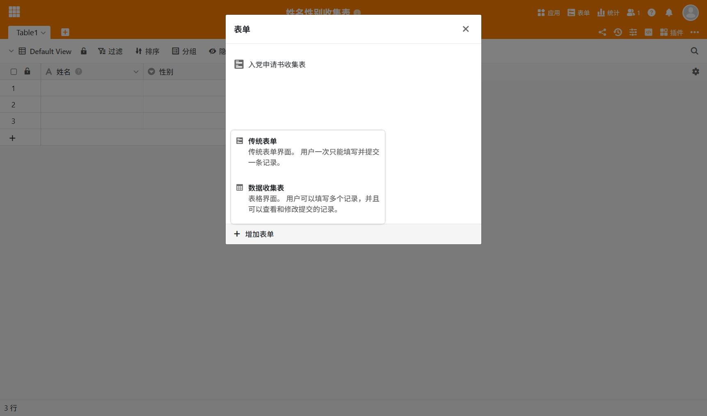
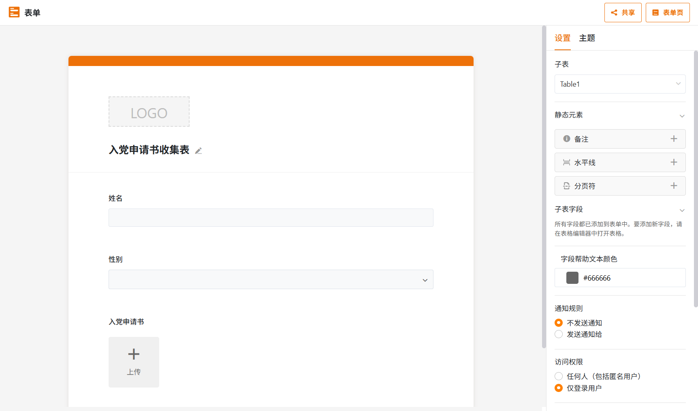

# 第 2 章：创建填写表单

表格字段已经定义了“数据怎样保存”，接下来要创建一个适合他人提交的页面。填写者通过表单提交一条记录，不需要进入表格后台。

## 本章目标

完成后，你将拥有一个包含文本、单选和文件上传区域的传统表单。

## 1. 选择传统表单

回到表格页面，点击右上角“表单”。在弹出的列表中选择“增加表单”，再选择“传统表单”。

<figure markdown="span">
  
  <figcaption>传统表单适合让填写者一次提交一条记录。</figcaption>
</figure>

传统表单和数据收集表的使用方式不同：传统表单更像一次性问卷；数据收集表允许填写者看到或修改多条记录。材料提交场景通常先选传统表单。

输入一个清楚的表单名称，例如“材料收集表”，点击“提交”进入编辑页。名称会显示给填写者，不要使用只有创建者看得懂的内部缩写。

## 2. 选择正确的子表

在右侧“设置”中找到“子表”，确认选择的是刚才配置字段的表，例如 `Table1`。

一个数据表文件中可能有多个子表。若选错子表，右侧字段列表会与预期不一致，提交结果也会进入错误的位置。

## 3. 把字段添加到表单

展开右侧“子表字段”。新建空白表单通常会显示“添加全部”，可以一次加入所有字段；也可以把单个字段拖到左侧预览区域。

<figure markdown="span">
  
  <figcaption>左侧是填写页面预览，右侧用于选择子表和添加字段。</figcaption>
</figure>

添加完成后，左侧至少应出现：

- 文本输入框。
- 单选或下拉选择框。
- 文件上传区域。

右侧出现“所有字段都已添加到表单中”时，说明当前子表的字段已经全部放入表单。

## 4. 调整填写顺序和提示

填写顺序应该符合人的操作习惯：先填写身份或标题，再选择类别，最后上传附件。字段较多时，可以把必填信息放在前面，把补充说明放在后面。

如果字段名称不足以说明要求，应增加简短的帮助文字，例如：

```text
附件：请上传 PDF 文件，文件名使用“姓名-材料名称”。
```

帮助文字应该告诉填写者怎样做，而不是重复字段名称。

## 5. 本章验收

在表单编辑页检查：

- 子表选择正确。
- 后台字段均出现在左侧预览中。
- 字段顺序符合填写流程。
- 上传字段旁有必要的格式或命名说明。
- 表单名称能让填写者知道自己正在提交什么。

不要在这里结束。表单结构完成后，还必须设置访问权限并从填写者视角测试链接。

## 常见问题

### 新增字段没有出现在表单中

先确认表单选择了正确子表，再展开“子表字段”手动添加。后台新增字段不会总是自动进入已有表单。

### 右侧显示的字段不对

通常是选错了子表。切换回保存目标字段的子表，再重新检查。

### 表单里出现了不该填写的列

在表单编辑页移除该字段即可，不必立即删除后台列。删除后台列可能同时删除已有数据。

👉 [下一章：设置权限并分享 →](03-permissions-and-sharing.md)
