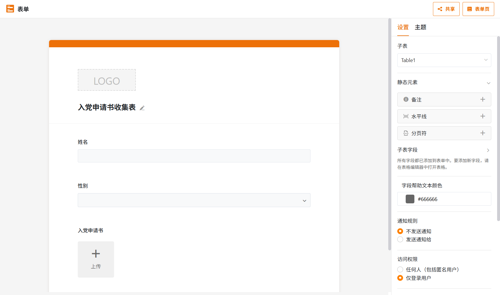
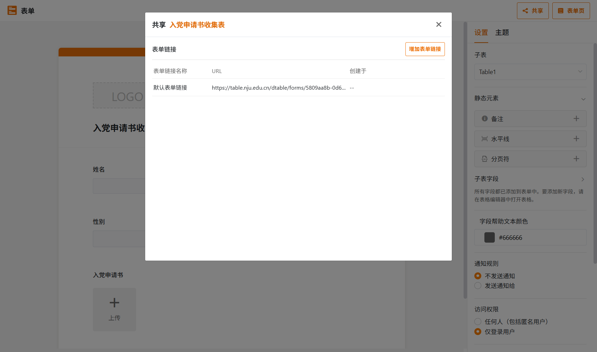

# 第 3 章：设置权限并分享

表单能显示不代表已经适合转发。分享前至少要回答两个问题：谁能打开，转发的到底是填写页还是后台编辑页？

## 本章目标

你将设置登录限制，找到正确的表单链接，并从填写者视角完成一次测试。

## 1. 设置仅登录用户填写

在表单编辑页右侧“设置”中向下滚动，找到“访问权限”，选择“仅登录用户”。等待页面显示已经保存。

<figure markdown="span">
  
  <figcaption>选择“仅登录用户”后，未登录访问者需要先按页面提示登录。</figcaption>
</figure>

重新打开编辑页，确认选项仍然保持。这个设置限制的是网站登录状态，不一定等于“只有指定名单中的人能填写”。如果任务需要更细的人员范围，应继续核实平台是否提供成员、群组或名单权限。

## 2. 获取填写链接

点击表单编辑页右上角“共享”，找到默认表单链接。也可以点击“表单页”打开实际填写页面，然后使用浏览器地址栏复制网址：

```text
Ctrl + L：选中地址栏
Ctrl + C：复制链接
Ctrl + V：粘贴到聊天窗口或文档
```

<figure markdown="span">
  
  <figcaption>应转发表单填写链接，不要转发表格后台或表单编辑地址。</figcaption>
</figure>

填写地址通常包含：

```text
/dtable/forms/
```

如果地址包含 `form-edit`，它通常是创建者使用的编辑页；如果地址进入表格后台，也不是面向填写者的提交入口。

## 3. 变更登录限制后是否要重新生成链接

已有默认表单链接通常可以继续使用。修改访问权限后，先重新打开原链接验证，不要因为设置变化就重复创建多个链接，以免群聊里同时流传新旧入口。

## 4. 用填写者视角测试

正式转发前，至少完成一次完整测试：

1. 使用无痕窗口或退出当前账号。
2. 打开填写链接，确认未登录时会先要求登录。
3. 登录后填写测试文本、选择一个选项并上传测试文件。
4. 提交后回到表格后台，确认新增了一行记录。
5. 检查文本、选项和附件是否分别进入正确列。
6. 删除测试记录，或给它加上明确的“测试”标记。

只在创建者账号中打开表单，无法充分验证普通填写者的权限和页面体验。

## 5. 转发时附上必要说明

不要只发送一条裸链接。建议同时说明：

- 收集什么内容。
- 哪些字段必须填写。
- 附件格式和命名规则。
- 提交截止条件。
- 填错后的处理方式或反馈渠道。

避免在公开群聊中发送不应公开的后台截图、身份信息或已提交材料。

## 本章验收

- 访问权限已保存为预期设置。
- 分享的是包含 `/dtable/forms/` 的填写页。
- 无痕窗口测试符合权限预期。
- 测试提交能在后台生成完整记录。
- 转发说明包含附件要求和反馈方式。

👉 [下一章：排错与安全 →](04-troubleshooting-and-safety.md)
